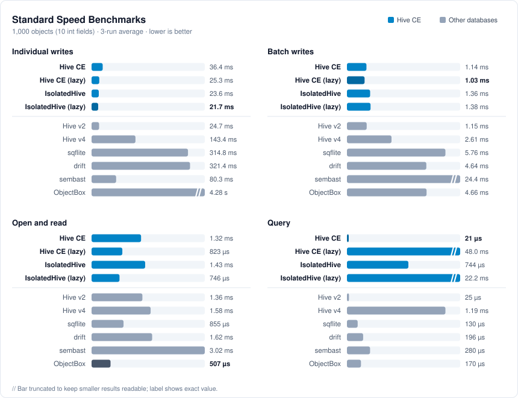
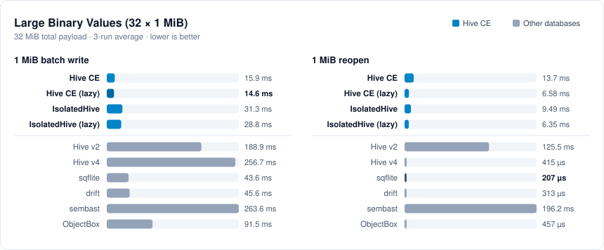
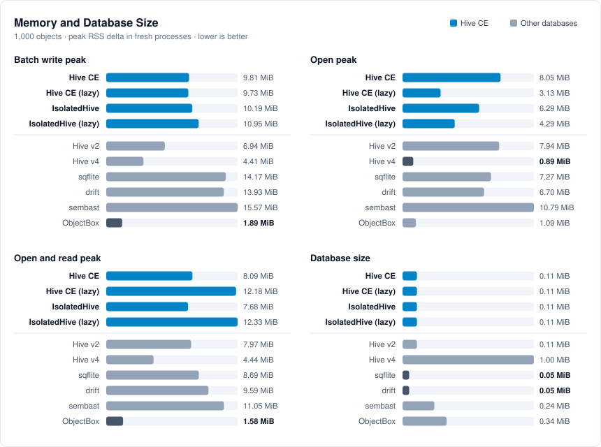

<p align="center">
  <picture>
    <source media="(prefers-color-scheme: dark)" srcset="https://raw.githubusercontent.com/IO-Design-Team/hive_ce/main/.github/logo_transparent_dark.svg">
    <source media="(prefers-color-scheme: light)" srcset="https://raw.githubusercontent.com/IO-Design-Team/hive_ce/main/.github/logo_transparent.svg">
    
  </picture>
</p>
<h2 align="center">Fast, Enjoyable & Secure NoSQL Database</h2>

<p align="center">
  <a href="https://github.com/IO-Design-Team/hive_ce/actions/workflows/test.yml"></a>
  <a href="https://codecov.io/gh/IO-Design-Team/hive_ce"></a>
  <a href="https://pub.dev/packages/hive_ce"></a>
  <a href="https://github.com/IO-Design-Team/hive_ce/blob/master/LICENSE"></a>
</p>

<p align="center">
  <a href="https://pubstats.dev/packages/hive_ce"></a>
  <a href="https://pubstats.dev/packages/hive_ce"></a>
  <a href="https://pubstats.dev/packages/hive_ce"></a>
</p>

Hive is a lightweight and blazing fast key-value database written in pure Dart. Inspired by [Bitcask](https://en.wikipedia.org/wiki/Bitcask).

### [Documentation & Samples](https://docs.hive.isar.community) 📖

## Features

- 🚀 Cross platform: mobile, desktop, browser
- ⚡ Great performance (see [benchmarks](#benchmarks))
- ❤️ Simple, powerful, & intuitive API
- 🔒 Strong encryption built in
- 🎈 **NO** native dependencies
- 🔋 Batteries included

## New features in Hive CE

Hive CE is a spiritual continuation of Hive v2 with the following new features:

- **Tooling**
  - Hive CE Inspector DevTools extension to browse and search the contents of your boxes
- **Platforms**
  - Isolate support through `IsolatedHive`
  - Flutter web WASM support
- **Code generation**
  - Generate adapters with the `GenerateAdapters` annotation instead of annotating every type and field
  - Generate adapters for classes outside the current package
  - Register every generated adapter in one call with the `HiveRegistrar` extension
  - Support for Freezed, constructor parameter defaults, and named imports
- **Types**
  - Built-in support for `Set` and `Duration`
  - `DateTime` and `Duration` keep microsecond precision
  - Type IDs up to `65439` instead of `223`
- **Performance**
  - Faster batch writes and opening of large boxes, including encrypted boxes
  - Lazy boxes open several times faster
  - `IsolatedHive` individual writes are faster than Hive CE
  - See the [benchmarks](#benchmarks)

## Getting Started

Hive CE requires Dart 3. Ensure that you have the following in your `pubspec.yaml` file:

```yaml
environment:
  sdk: ^3.0.0
```

## Usage

You can use Hive just like a map. Writes are readable immediately, but a write can be lost if the process is killed before its future completes. On the VM, `flush()` waits for pending writes and flushes them to disk.

<!-- embedme readme/usage.dart -->

```dart
import 'package:hive_ce/hive_ce.dart';

void example() {
  final box = Hive.box('myBox');
  box.put('name', 'David');
  final name = box.get('name');
  print('Name: $name');
}

```

## Benchmarks

With 1 MiB values, Hive CE batch writes were **11.8× faster** and reopening was
**9.2× faster** than Hive v2. Hive CE and IsolatedHive use zlib for CRC32,
enabled by `Hive.initFlutter()` from `package:hive_ce_flutter`. Hive v2
computes CRC32 in Dart.







<details>
<summary>Measurement details</summary>

- macOS release build on an Apple M3 Max. All results are averages of three runs.
- Batch writes include a flush where needed. Hive v4, sqflite, drift, and
  ObjectBox commit each individual write.
- The range query returns 100 matches. The disk sizes for sqflite, drift, and
  ObjectBox include the index used by the query.
- The standard open-and-read timing loads keys for lazy boxes and values for
  other databases. The memory read measures loading values for every database.
  Batch write memory includes creating the input values.
- The 1 MiB reopen timer stops before the payloads are read back for validation.
  Hive v4 stores the values as base64 strings, and Sembast uses its Blob type.

</details>

[Run the benchmarks](https://github.com/IO-Design-Team/hive_ce/tree/main/benchmarks)
